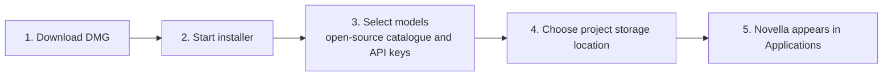
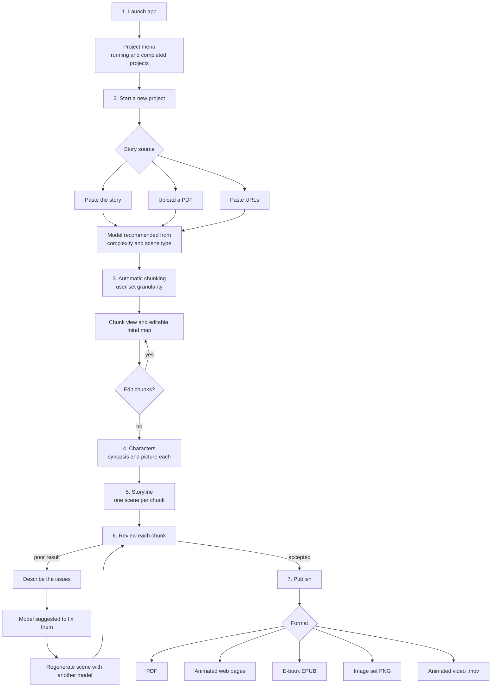

# Novella: End-to-End Product Specification

| | |
|---|---|
| Version | 0.1 (draft for implementation) |
| Date | 19 October 2026 |
| Owner | Ayan |
| Licence target | Apache-2.0 where possible (code owned by the owner) |
| Platform | macOS desktop app, distributed as a DMG |
| Source | Hand-drawn sketch "New UX Flows for Novella", then clarified through review comments on the feature specification document |

---

## 0. How to use this document (instructions for the Claude Code session)

This is the single source of truth for building Novella. Read it fully before writing code.

1. **Requirement IDs (F1 to F26) are stable.** Reference them in branch names, commit messages, tests and code comments, for example `feat(F24): chunk granularity setting`.
2. **Every requirement carries a provenance tag** so you know how firm it is:
   - `[Sketch]` came from the owner's handwritten sketch.
   - `[Review]` was stated by the owner in review comments after the sketch. Treat as confirmed.
   - `[Suggested]` is a proposal made while writing the spec. Implement it as the default, but flag it in your summary so the owner can confirm or change it.
   - `[Assumption]` is a reading of ambiguous handwriting or a gap filled to make the spec buildable. Confirm with the owner before building anything that depends on it.
3. **Sections 7 and 8 (data model and architecture) are proposals**, not requirements. The requirements are in sections 4 to 6, 9 and 10. If you have a better design that still meets every acceptance criterion, propose it and explain why.
4. **Confirm the technology stack with the owner in your first session** (section 8.2) before scaffolding the app.
5. **Do not invent product behaviour.** Where this document is silent, choose the simplest option, note it in `DECISIONS.md`, and keep going. Where a silence blocks a requirement, ask.
6. **Work milestone by milestone** (section 11). Each milestone has exit criteria. Write tests that map to the acceptance criteria.
7. **Never commit secrets.** No API keys, model weights or user content in the repository.
8. **Keep the repository open-source ready from the first commit** (section 10): Apache-2.0 `LICENSE`, `NOTICE`, a third-party licence ledger, and licence headers where appropriate.

---

## 1. Product summary

**Novella turns a story into a comic book.** The user supplies a story (pasted text, a PDF, or URLs). Novella splits it into chunks, finds the key characters, lets the user give each character a picture, then generates one scene per chunk using AI models the user chooses. The user reviews every chunk, can regenerate any scene with a different model, and finally publishes the finished comic in the format they want.

### 1.1 Goals

- Give a non-technical user a guided, visual route from story text to a finished comic.
- Let the user choose their own models, both downloadable open-source models and frontier models reached through their own API key.
- Help the user choose well, by recommending models and showing cost against performance for each prompt stage.
- Keep control with the user: every chunk can be reviewed and regenerated, and chunks can be edited.
- Run as an installable Mac app with all projects stored on the user's own drive.
- Be an open-source project that others can build on, use and extend.

### 1.2 Non-goals for the first release

All `[Suggested]`; confirm with the owner.

- No hosted or cloud service operated by the project. Everything runs on the user's Mac, except calls the user chooses to make to frontier model APIs.
- No multi-user collaboration or accounts.
- No Windows or Linux build.
- No capture or analysis of user feedback on model quality (the "feedback" half of a cut-off sketch note is explicitly out of scope `[Review]`).
- No telemetry by default `[Suggested]`, see section 9.

### 1.3 Target user

An individual creator who has a story and wants a comic, and who may or may not be comfortable with AI tooling `[Assumption]`. The interface must not assume technical knowledge of models, which is why Novella recommends models and explains cost against performance.

---

## 2. Glossary

| Term | Meaning |
|---|---|
| Story | The full source text of a project, from pasted text, a PDF or URLs. |
| Chunk | An ordered section of the story. One scene is generated per chunk. |
| Scene | The generated comic output for one chunk. |
| Character | A key character found in the story, with a synopsis and a picture. |
| Project | One story and everything derived from it. Has a state of running or completed. |
| Model | An AI model Novella can call. Either open-source (downloaded and run locally) or frontier (called through an API with the user's key). |
| Default model / project model | The model used for a project unless overridden. Chosen from Novella's recommendation. |
| Prompt stage | A step in which Novella sends a prompt to a model, for example chunking, character extraction, scene generation. |
| Scene type | The kind of scene being generated, for example landscape, human figures, drama. |
| Complexity | How demanding a prompt or story is for a model. Drives model recommendations. |
| Provider | An adapter that talks to a model source: a local runtime or a frontier API. |
| Catalogue | The list of open-source models offered for download at install. |

---

## 3. Provenance legend and scope summary

| Tag | Count of requirements | Meaning |
|---|---|---|
| `[Sketch]` | 17 core | Directly drawn in the handwritten sketch (F1 to F17, plus part of F18) |
| `[Review]` | 9 | Added or clarified by the owner in review (F18 to F26, and clarifications to earlier items) |
| `[Suggested]` / `[Assumption]` | Inline | Marked next to the specific detail |

Decisions the owner has confirmed in review, so you should not re-ask:

- The first step of the user flow, "select the App machine", means **launching the app**.
- "Dry file" in the installation flow means **a DMG file**.
- Models come from **both** a downloadable catalogue of open-source models **and** frontier models via the user's API keys.
- A character picture can be **uploaded or generated-and-picked**; both must exist.
- Chunking is **automatic and editable**; the user sets the **granularity**; the mind map is **editable** and its edits update the chunks.
- "Cost of prompt" means a **cost versus performance view** of models at each prompt stage.
- The model recommendation is driven by **complexity and scene type** (landscape, human figures, drama and similar).
- **All** publication formats are selectable: PDF, animated web pages (self-contained), e-book (EPUB), image set (PNG) and animated video (.mov).
- Animated web pages are **self-contained files**, no hosting needed.
- Licence is **Apache-2.0 where possible**; **the code belongs to the owner**.
- The open-source package must include tooling that **generates a new DMG when the software is upgraded**.

---

## 4. User journeys

### 4.1 Installation flow



Steps:

1. The user downloads a DMG file. `[Sketch]` (reading "dry file" as DMG is `[Assumption]` now confirmed.)
2. The user starts the installer. `[Sketch]`
3. The user selects the models to make available for comic book generation, from a catalogue of open-source models to download, and from frontier models connected by API key. `[Sketch]` + `[Review]`
4. The user selects the drive location where Novella projects are stored. `[Sketch]`
5. When the wizard finishes, Novella appears in the Mac Applications folder. `[Sketch]`

Consequences: model choice happens before first launch, so the installer must list models, download the open-source ones chosen, and capture API keys. The storage location is set once at install and applies to all projects.

### 4.2 User flow



At every prompt stage Novella can show a **cost versus performance view** of the models suited to that prompt's complexity (F18). Model advice appears at two points: after story input (F9) and during review (F17).

---

## 5. Functional requirements

Acceptance criteria are written to be testable. Items marked `[Suggested]` inside a criterion are proposals within an otherwise confirmed requirement.

### 5.1 Installation and setup

| ID | Requirement | Acceptance criteria | Provenance |
|---|---|---|---|
| F1 | **Mac installer.** Novella installs from a DMG through a guided installer. | The app appears in Applications after the wizard completes. Wizard steps run in the order in section 4.1. | `[Sketch]` |
| F2 | **Model selection at install.** The user picks which models are available for comic book generation. | Only selected models appear in the app. At least one model must be chosen `[Assumption]`. | `[Sketch]` |
| F3 | **Project storage location.** The user chooses the drive location where projects are saved. | New projects are written under the chosen location. | `[Sketch]` |
| F22 | **API keys for frontier models.** An interface to enter and store the API key for frontier models such as Claude or OpenAI. | A key can be added, replaced and removed. Its models then appear in model selection. Keys are stored securely on the Mac and never in project files (`[Suggested]`: macOS Keychain). | `[Review]` |
| F23 | **Open-source model catalogue.** A catalogue of open-source models that can be downloaded at install time. | Each model is listed with its name and download size `[Suggested]`. Chosen models download during install and then appear in model selection. | `[Review]` |
| F26 | **DMG generation on upgrade.** The open-source package includes tooling that generates a new DMG whenever the software is upgraded. | Releasing a new version produces a new installable DMG without manual packaging steps. | `[Review]` |

Behaviour notes:

- **Model selection screen** has two groups: *Open-source models* (from the catalogue, with name, size and licence, each with a download option) and *Frontier models* (grouped by provider, with an API key field per provider). `[Suggested]`
- **Frontier providers** at launch: Anthropic (Claude) and OpenAI, with the provider interface (section 8.3) designed so more can be added. The owner said "Claude or OpenAI etc", so extensibility is required.
- **Key handling** `[Suggested]`: validate a key with a minimal test call when entered; show success or a clear error; never display the full key again after saving; allow removal. Because F22 requires keys to be replaceable and removable, keys must also be manageable **after install** in a Settings screen `[Assumption]`.
- **Catalogue** `[Suggested]`: a manifest file in the repository (`catalogue/models.json`) listing each model: id, display name, task type (text or image), licence, download size, source URL, checksum, and a short description. The repository holds the manifest only, never the weights. Downloads show progress, can be cancelled, and are verified against the checksum.
- Model changes after install (add or remove models or keys) must also be possible from Settings `[Assumption]`, since the sketch describes install-time choice only.

### 5.2 Projects and story input

| ID | Requirement | Acceptance criteria | Provenance |
|---|---|---|---|
| F4 | **Project menu.** Home screen listing running and completed projects. | Each project shows a running or completed state. Selecting one opens it. | `[Sketch]` |
| F5 | **New project.** Starts a project from the project menu. | A new project is created and asks for a story source. | `[Sketch]` |
| F6 | **Paste story.** Accepts the story as pasted text. | Pasted text becomes the project's full story. | `[Sketch]` |
| F7 | **Upload PDF.** Accepts the story as an uploaded PDF. | Text is extracted from the PDF and becomes the full story. | `[Sketch]` |
| F8 | **Paste URLs.** Accepts one or more URLs as the story source. | Page content from each URL is fetched and combined into the full story. | `[Sketch]` |

Behaviour notes:

- The sketch shows three source options but does not say whether they can be **combined** in one project. Default: one source type per project, with multiple URLs allowed. `[Assumption]`, ask the owner.
- Show the extracted full story to the user before chunking so they can see what Novella will work from. `[Suggested]`
- Handle extraction failures (unreadable PDF, unreachable URL, empty result) with a clear message and a way to retry or change the source. `[Suggested]`
- A project's state is **running** until the user publishes or marks it done, then **completed** `[Assumption]`.

### 5.3 Model advice

| ID | Requirement | Acceptance criteria | Provenance |
|---|---|---|---|
| F9 | **Context-based model recommendation.** Recommends a model based on story complexity and scene type (landscape, human figures, drama and similar). | A recommended model is shown before chunking. The user can accept or change it. | `[Sketch]` + `[Review]` |
| F17 | **Prompt-driven model advice.** Accepts a prompt describing the issues found and recommends which model can solve them. | After the prompt is submitted, a recommended model is offered for regeneration. | `[Sketch]` |
| F18 | **Cost versus performance view.** For each prompt stage, shows a cost versus performance view of the models suited to the prompt's complexity. | Each candidate model shows its relative cost and expected performance for that prompt's complexity, with a recommended model marked. Metrics to be defined. | `[Sketch]` (cut-off note) + `[Review]` |

See section 6 for the proposed mechanics of recommendation and the cost versus performance view.

### 5.4 Chunking and mind map

| ID | Requirement | Acceptance criteria | Provenance |
|---|---|---|---|
| F10 | **Visual story chunking.** Automatically splits the full story into ordered chunks and shows them visually. | Chunks 1 to n display in order, each traceable to its part of the full story. | `[Sketch]` + `[Review]` |
| F11 | **Visual mind map.** An editable mind map of the story chunks. | The mind map is available from the chunk view, reflects the current chunks, and edits made in it update the chunks. | `[Sketch]` + `[Review]` |
| F24 | **Chunk granularity setting.** The user specifies how finely the story is chunked automatically. | The user can set granularity before chunking runs (for example a target number of chunks or chunk length, `[Suggested]`). Changing it re-chunks the story. | `[Review]` |
| F25 | **Edit chunks.** The user edits the automatic chunks. | The user can change where chunks begin and end (for example merge or split, `[Suggested]`). The chunk view and mind map reflect the change. | `[Review]` |

Behaviour notes:

- The sketch draws the chunk view as the full story on the left with arrows to Chunk 1, 2, 3, 4 on the right, in order. Keep the visual link from each chunk back to its source span in the story.
- Re-chunking after the user has edited chunks would discard those edits. Warn before doing it. `[Suggested]`
- If chunks change after characters or scenes exist, mark affected scenes as out of date rather than silently regenerating. `[Suggested]`
- Mind map editing operations should at least cover reorder, merge, split and rename. `[Suggested]`

### 5.5 Characters

| ID | Requirement | Acceptance criteria | Provenance |
|---|---|---|---|
| F12 | **Key character list.** Lists all key characters in the story, each with a synopsis. | Every named key character appears with a synopsis. The list covers characters 1 to n. | `[Sketch]` |
| F13 | **Character image.** The user picks a picture for each character by uploading their own or by generating options and choosing one. | Each character can have one image, either uploaded or chosen from generated options, stored with the project. | `[Sketch]` + `[Review]` |

Behaviour notes:

- The sketch shows "character 1 - synopsis" with "allow me to select a character picture", a dotted line, then "character n". Build a list view with one row or card per character.
- Characters should be editable (name, synopsis) and the user should be able to add one that Novella missed. `[Suggested]`
- Character images feed the storyline step (F14). A scene should show the characters that appear in its chunk using their chosen pictures.

### 5.6 Generation and review

| ID | Requirement | Acceptance criteria | Provenance |
|---|---|---|---|
| F14 | **Storyline visualisation.** Uses the characters to visualise the story as a storyline organised by chunk. | Each chunk shows a generated scene featuring the chosen character images. | `[Sketch]` |
| F15 | **Per-chunk review.** The user reviews the generated output of every chunk. | Each chunk can be opened and judged before the project is completed. | `[Sketch]` |
| F16 | **Regenerate with a different model.** Regenerates a scene with another model when the default or project model performs poorly. | The user picks any installed model and the chunk is regenerated without affecting other chunks. | `[Sketch]` |

Behaviour notes:

- Generation of many scenes is long-running. Run it as background jobs with visible per-chunk progress, cancel and retry. `[Suggested]`
- Keep **previous versions** of a regenerated scene so the user can compare and go back. `[Suggested]`
- Regenerating one chunk must not change any other chunk's scene (F16 criterion).
- "Installed model" in F16 means any model the user selected at install or added later, including frontier models with a stored key.

### 5.7 Publication

| ID | Requirement | Acceptance criteria | Provenance |
|---|---|---|---|
| F19 | **Publish as PDF.** Exports the finished comic as a PDF. | A PDF is produced with every chunk's scene in story order. | `[Review]` |
| F20 | **Publish as animated web pages.** Exports the comic as self-contained animated web pages viewable in a browser. | Pages open in a standard browser and show every chunk's scene, animated, in story order. The export is self-contained and needs no hosting. | `[Review]` |
| F21 | **Further export formats.** An e-book (EPUB), an image set (PNG) and an animated video (.mov) as extra publication options. | Every publication format, including PDF and animated web pages, can be selected by the user and produces a file. | `[Review]` |

Behaviour notes:

- Publishing is **step 7** of the user flow and comes after review. The user chooses a format, or several, and Novella writes the output into the project's `exports/` folder.
- "Self-contained" for F20 means a single file or a folder that works offline by double-clicking, with all images, styles and scripts included, and no external hosting or network access. `[Assumption]` on the exact packaging; a single HTML file with embedded assets is the simplest reading.
- The sketch gives no layout rules for comic pages (panels per page, page size, speech bubbles, captions). Choose a simple default and record it in `DECISIONS.md`. `[Assumption]`
- The animation style of F20 and F21's video is undefined. Simple per-scene transitions is the minimal acceptable default. `[Assumption]`

---

## 6. Model management

### 6.1 Three levels of model choice

1. **Installed set.** The user picks the available models once, during installation (F2), choosing from the open-source catalogue (F23) and adding API keys for frontier models (F22). Managing this later in Settings is `[Assumption]`.
2. **Project model.** After story input, Novella recommends a model (F9) driven by the complexity of the story and the type of scene to generate. The user keeps it or changes it. It becomes the project default.
3. **Per-chunk override.** If the default or project model performs poorly on a chunk, the user regenerates that scene with another installed model (F16). The user can describe the problem in a prompt and Novella recommends the model best placed to fix it (F17).

### 6.2 Recommendation inputs `[Suggested]`

The owner confirmed two drivers: **complexity** and **scene type** (landscape, human figures, drama and similar). Proposed approach:

- Classify each chunk by scene type and complexity. A first version can use a cheap model or heuristics (story length, number of characters, amount of dialogue).
- Maintain, for every model in the catalogue and every frontier provider, a **capability profile**: which scene types it handles well and at what complexity. Store profiles in a versioned data file in the repository so the community can improve them.
- Recommend the model whose profile best fits the chunk, among models that are actually available (installed, or key present).
- Always let the user override the recommendation.

### 6.3 Cost versus performance view (F18) `[Suggested]` mechanics, metrics to be defined

At each **prompt stage**, show the candidate models side by side:

- **Prompt stages** that call a model: story clean-up if needed, chunking, scene-type and complexity analysis, character extraction, character image generation, scene generation, regeneration. Treat the exact list as a proposal.
- **Cost:** for frontier models, an estimate from expected tokens or images and the provider's price; for local models, no money cost but an estimated time and compute load.
- **Expected performance:** a simple tier or score (for example 1 to 5) for the stage's complexity, taken from the capability profile in 6.2.
- **Recommended** marker on the model with the best performance for the lowest sensible cost at that complexity.
- Show it as a compact comparison, not a wall of numbers. The owner said "metrics to be defined", so keep the metric set small and replaceable.

Cost figures are estimates. Label them as such, and never hard-code prices; read them from a configuration file that can be updated.

### 6.4 Regeneration behaviour (F16, F17)

- The review screen offers **Regenerate** on each chunk.
- Regenerating opens a model picker, with the recommendation from F17 if the user typed a description of the issues, plus the F18 view.
- The new output is stored as a new version of that scene. Other chunks are untouched.

---

## 7. Data model (proposed)

Entities, with fields to start from. Adjust as the implementation needs.

```text
Settings
  storageRoot            path chosen at install (F3)
  selectedModelIds[]     models enabled by the user (F2)
  providerKeyRefs{}      provider -> Keychain item reference (never the key itself)

ModelEntry
  id, displayName, kind (local | frontier), provider
  capabilities[]         text, image
  licence, sizeBytes, sourceUrl, checksum   (catalogue entries)
  installed (bool)

Project
  id, title, state (running | completed)
  createdAt, updatedAt
  sources[]              { type: text | pdf | url, ref }
  fullStoryText
  projectModelId
  chunking { mode: targetCount | targetLength, value }
  chunks[], characters[], scenes[], exports[]

Chunk
  id, index, span { start, end }   offsets into fullStoryText
  summary, sceneType, complexity

Character
  id, name, synopsis
  image { source: uploaded | generated, path }
  generatedOptions[]

Scene
  id, chunkId, status (pending | running | done | failed | outOfDate)
  versions[] { n, modelId, prompt, outputPath, createdAt }
  currentVersion

Export
  id, format (pdf | web | epub | png | mov), path, createdAt
```

Suggested on-disk layout under `storageRoot`, so a project is a normal folder the user can back up or move:

```text
<storageRoot>/<project-slug>/
  project.json
  story/            source files and extracted text
  chunks.json
  characters/       images and metadata
  scenes/<chunk-id>/v1, v2, ...
  exports/          pdf, web, epub, png, mov outputs
```

API keys are never written into this folder.

---

## 8. Architecture (proposed)

### 8.1 Components

- **App shell and UI:** installer-launched Mac app with screens for Settings, Project menu, New project, Chunk view with mind map, Characters, Storyline, Review, Publish.
- **Core services:** project store, story ingestion (text, PDF, URL), chunking, characters, scene generation orchestrator, model advisor, exporters.
- **Model layer:** a provider interface (8.3) with adapters for local runtimes and frontier APIs, a catalogue manager (download, verify, remove), and a key store.
- **Job runner:** background queue with progress, cancel, retry, and per-chunk isolation.
- **Release tooling:** scripts and CI that build, sign, notarise and package a DMG for each version (F26).

### 8.2 Technology stack: decision needed in session one

No stack was specified. Recommended default, to confirm with the owner before scaffolding:

| Option | For | Against |
|---|---|---|
| **Tauri 2 with a TypeScript and React UI, Rust core** (recommended) | The editable mind map, chunk view and storyline are web-native UI; the animated web export can reuse the same rendering code; small DMG; Keychain access through a Rust crate. | Local model runtimes sit outside the app process regardless of stack; two languages. |
| Native Swift and SwiftUI | First-class Mac integration, Keychain, signing and notarisation; direct use of Apple's ML frameworks. | A rich mind map editor and an animated web exporter take more effort; the owner may prefer web tooling. |
| Electron | Largest ecosystem for web UI. | Large DMG, heavier memory use. |

Whatever is chosen, keep model access behind the provider interface so the UI and orchestration never depend on one runtime.

Local open-source models normally run through a separate runtime process (for example an Ollama-style or llama.cpp-style server for text, and a diffusion runner for images). Treat those as managed child processes that Novella installs, starts and stops. The exact runtimes and model entries are a build decision recorded in `DECISIONS.md`.

### 8.3 Provider interface (sketch)

```text
interface ModelProvider {
  id: string
  kind: "local" | "frontier"
  listModels(): ModelEntry[]
  isAvailable(model): boolean              // installed, or key present
  generateText(request): TextResult
  generateImage(request): ImageResult
  estimateCost(request): CostEstimate      // for the F18 view
}
```

Add a new provider by adding one adapter and its catalogue or profile entries, with no changes to the UI.

### 8.4 Security and privacy design

- API keys live only in the macOS Keychain (`[Suggested]`) and are read at call time.
- Projects and their content stay on the user's drive. Nothing is sent anywhere except the prompts and images the user chooses to send to a frontier provider.
- No telemetry by default. If any is added later, it must be opt-in.
- Verify downloaded models against checksums from the catalogue manifest.
- Treat story text, PDF content and fetched web pages as untrusted input. Sanitise before rendering, and never execute content from them.

---

## 9. Non-functional requirements

All `[Suggested]` unless noted. Numeric targets are to be defined with the owner once there is a working build.

- **Privacy and ownership:** stories and character images belong to the user and stay on the user's drive `[Sketch/Review]`. No telemetry by default.
- **Security:** keys in Keychain, never in project files, logs or crash reports.
- **Responsiveness:** long operations (download, ingestion, generation, export) run in the background with progress and cancel. The UI never freezes.
- **Isolation:** a failure or regeneration in one chunk must not affect other chunks (F16).
- **Recoverability:** project data is saved continuously so quitting mid-generation loses at most the running job.
- **Compatibility:** macOS only. Minimum macOS version and chip support (Apple silicon, Intel or both) to be decided at stack selection and documented.
- **Accessibility:** keyboard navigation and screen-reader labels on the main flows, and sensible contrast.
- **Licence hygiene:** maintain a ledger of third-party dependencies and model licences, and surface each model's licence in the catalogue UI.
- **Offline behaviour:** everything except frontier calls, URL fetching and model downloads works offline.

---

## 10. Open-source approach and release

### 10.1 Decisions

| Decision | Choice | Notes |
|---|---|---|
| Licence | **Apache-2.0 where possible** `[Review]` | Permissive, adds a patent grant. Where a dependency's licence prevents it, that part keeps its own licence. |
| Ownership | The code belongs to the owner `[Review]` | The owner sets the licence. Third-party code and models keep their own licences and terms. |
| Repository files | `README`, `LICENSE`, `NOTICE`, `CONTRIBUTING`, `CODE_OF_CONDUCT`, `SECURITY` | The README reuses the installation flow in section 4.1. |
| Distribution | Source on GitHub, and a new signed DMG on GitHub Releases for each version | Keeps the F1 installer while letting developers build from source. |
| Models | Bring your own models. No weights or API keys in the repository | The installer points to each model's source and licence rather than bundling it. |
| User content | Projects stay on the user's drive (F3). No telemetry by default | |
| Governance | One maintainer to start. Issues and pull requests open to all | More maintainers can join later. |

This is general information, not legal advice. Check the licence choice with a lawyer if the project has commercial plans.

### 10.2 Release pipeline (F26)

- A single command, and a CI workflow, builds the app, creates the DMG, signs it, notarises it with Apple, and uploads it to GitHub Releases whenever a new version is tagged.
- Signing and notarisation need an Apple Developer ID. The owner must supply credentials as CI secrets. Do not commit them.
- Contributors without signing credentials must still be able to build an unsigned DMG locally from source with one documented command.
- Acceptance: tagging a release produces an installable DMG without manual packaging steps.
- Consider an in-app check for a newer version that links to the GitHub release. `[Suggested]`, not required by the owner.

---

## 11. Delivery plan (suggested milestones)

Each milestone should leave the app in a runnable state and add tests mapped to the acceptance criteria.

| Milestone | Scope | Requirements | Exit criteria |
|---|---|---|---|
| M0 Foundations | Repo, licence files, stack decision recorded, app skeleton, CI, provider interface stub, `DECISIONS.md` | Section 10 basics | App launches; CI builds; licence files in place |
| M1 Install and setup | Installer wizard, storage location, Settings, key store, model catalogue and downloads | F1, F2, F3, F22, F23 | A fresh Mac install reaches the project menu with chosen models and location |
| M2 Projects and story input | Project menu, new project, paste, PDF, URLs, extraction | F4, F5, F6, F7, F8 | A story from each source becomes a project's full story |
| M3 Chunking and mind map | Automatic chunking, granularity, chunk view, editable mind map | F10, F11, F24, F25 | Chunks display in order; edits in view and mind map stay in sync |
| M4 Model advice | Scene type and complexity analysis, recommendation, cost versus performance view | F9, F18 (and base for F17) | A recommendation shows before chunking and the F18 view shows at stages |
| M5 Characters | Extraction with synopsis, upload and generate-and-pick pictures | F12, F13 | Every key character has a synopsis and a chosen image |
| M6 Generation and review | Scene generation by chunk, review, regeneration, prompt-driven advice, versions | F14, F15, F16, F17 | Any chunk can be regenerated with another model without affecting others |
| M7 Publication | PDF, self-contained animated web pages, EPUB, PNG, .mov | F19, F20, F21 | Every format produces a correct file in story order |
| M8 Release and hardening | DMG generation tooling, signing and notarisation, docs, contributor guide | F26 | Tagging a version publishes a signed, installable DMG |

---

## 12. Open items and decisions for the build session

Confirm with the owner, in this order of impact:

1. **Technology stack** (section 8.2), and minimum macOS version and chip support.
2. **Local model runtimes and the first catalogue entries**, for text and image models, including each model's licence.
3. **Can story sources be combined** (paste plus PDF plus URLs) in one project?
4. **Cost versus performance metrics** for F18: which numbers, and where the capability profiles come from.
5. **Comic layout and animation style** for the output: panels per page, page size, text bubbles or captions, transition style.
6. **Settings after install**: confirm that models and keys can be managed after install, not only during it.
7. **Project completion**: what moves a project from running to completed.

Explicitly out of scope: capturing or analysing user feedback on model quality.

---

## Appendix A: Traceability

| ID | Feature | Source in sketch or review |
|---|---|---|
| F1 | Mac installer | Installation flow, steps 1, 2, 5 |
| F2 | Model selection at install | Installation flow, step 3 |
| F3 | Project storage location | Installation flow, step 4 |
| F4 | Project menu | User flow, step 1 |
| F5 | New project | User flow, step 2 |
| F6 | Paste story | User flow, step 2 |
| F7 | Upload PDF | User flow, step 2 |
| F8 | Paste URLs | User flow, step 2 |
| F9 | Context-based model recommendation | User flow, left margin note; review: driven by complexity and scene type |
| F10 | Visual story chunking | User flow, step 3; review: automatic |
| F11 | Visual mind map | User flow, right-hand note; review: editable |
| F12 | Key character list | User flow, step 4 |
| F13 | Character image | User flow, step 4; review: upload or generate-and-pick |
| F14 | Storyline visualisation | User flow, step 5 |
| F15 | Per-chunk review | User flow, step 6 |
| F16 | Regenerate with a different model | User flow, step 6 |
| F17 | Prompt-driven model advice | User flow, step 6 |
| F18 | Cost versus performance view | Top of page 1 (cut off), review comment |
| F19 | Publish as PDF | Review comment, step 7 |
| F20 | Publish as animated web pages | Review comment, step 7 |
| F21 | Further export formats | Review comment, step 7 |
| F22 | API keys for frontier models | Review comment, installation step 3 |
| F23 | Open-source model catalogue | Review comment, installation step 3 |
| F24 | Chunk granularity setting | Review comment, step 3 |
| F25 | Edit chunks | Review comment, step 3 |
| F26 | DMG generation on upgrade | Review comment, installation flow |

## Appendix B: Reading of the handwritten sketch

For reference when something in this spec seems to differ from the sketch. Handwriting readings are marked.

**Installation flow:** Download a DMG file (written "dry file", read as DMG); start an installer; select the models you want to have available for comic book generation (written "cowie books", read as comic books); select your location on the drive for storing Novella projects; app appears as Mac app.

**User flow:** Select the app (written "App machine", confirmed as launching the app); menu of running projects and completed projects; start a new project; paste the story, upload a PDF, or paste URLs; show story chunks visually (full story box with arrows to Chunk 1 to Chunk 4); left margin note: recommend a model based on context; right-hand bracket: allow the user to get a visual mind map; list all the key characters in the story and associate an image (character 1 with a synopsis, then "allow me to select a character picture", a dotted line, then character n); use the characters from the previous step to visualise the storyline organised by chunks; for every chunk allow the user to review the output and then regenerate the scene using a different model if the default or project model does not perform well; accept a prompt and recommend which model can solve the issues highlighted.

**Cut-off fragment at the top of page 1:** a box labelled "cost of prompt" and "feedback". Review decision: "cost of prompt" became the cost versus performance view (F18); "feedback" is out of scope.

## Appendix C: Review decisions log

| Topic | Decision |
|---|---|
| App launch | Step 1 is launching the app |
| Distribution | DMG; the open-source package generates a new DMG on each upgrade (F26) |
| Model sources | Open-source catalogue downloadable at install, plus frontier models via API keys (F22, F23) |
| Character pictures | Upload, or generate and pick (F13) |
| Chunking | Automatic with user-set granularity, and editable (F10, F24, F25) |
| Mind map | Editable; edits update chunks (F11) |
| Model recommendation drivers | Complexity and scene type (F9) |
| Cost of prompt | Cost versus performance view per prompt stage (F18) |
| Feedback | Out of scope |
| Publication formats | PDF, animated web pages, EPUB, PNG image set, animated .mov; all selectable (F19 to F21) |
| Animated web pages | Self-contained, no hosting (F20) |
| Licence and ownership | Apache-2.0 where possible; code belongs to the owner |
